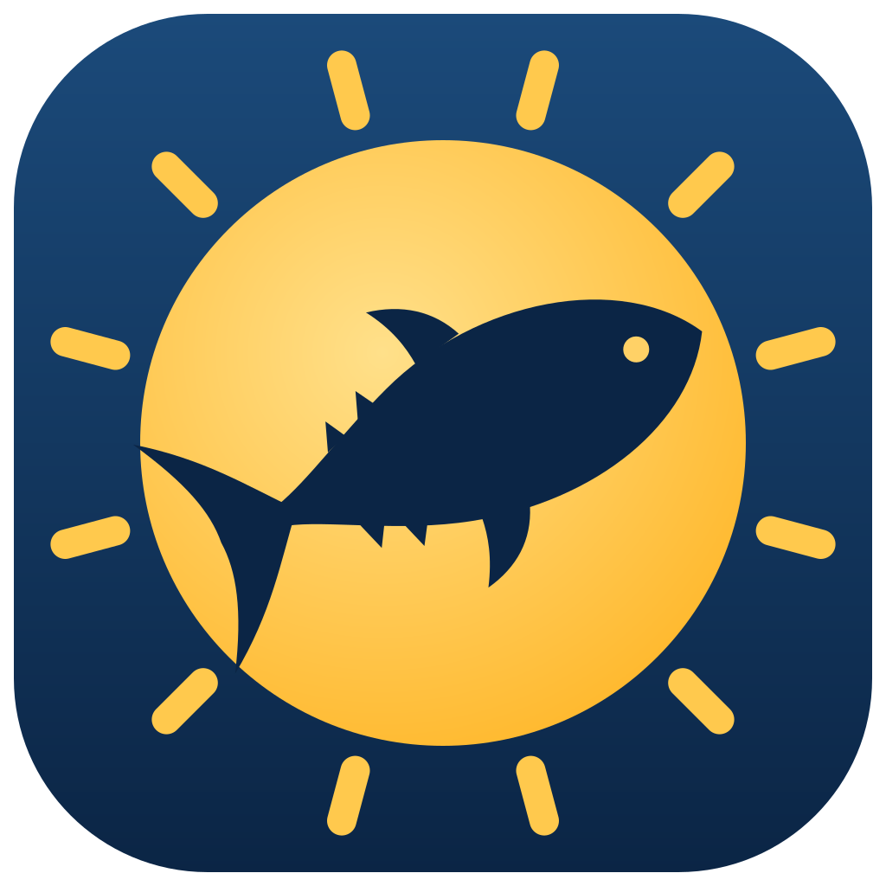
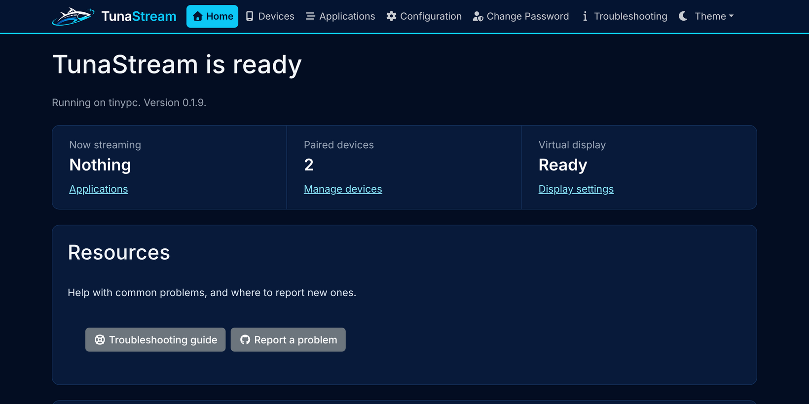
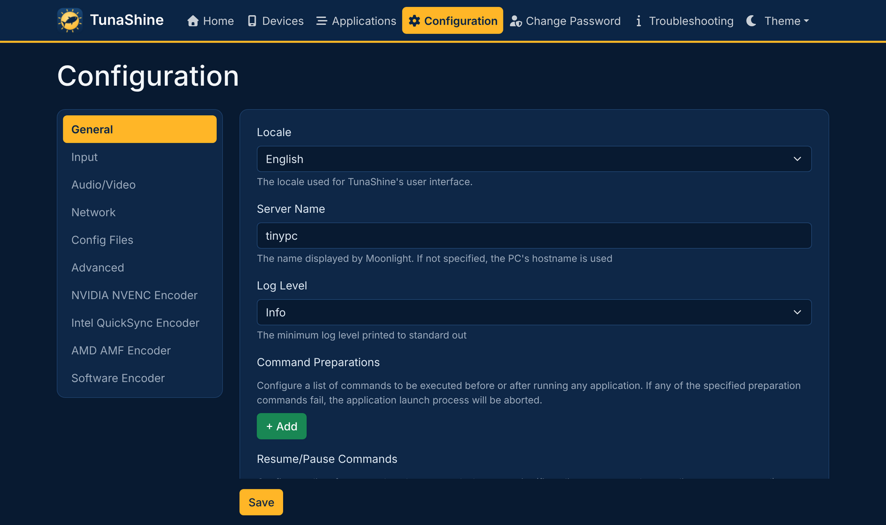

  

<h1 align="center">TunaShine</h1>

  Play your PC's games on your phone, tablet, handheld or TV. 
  A self-hosted streaming host for Windows that works with <a href="https://moonlight-stream.org">Moonlight</a>.

  

TunaShine runs on your gaming PC and streams it to another device over your network. It is a fork of
[Apollo](https://github.com/ClassicOldSong/Apollo), which is a fork of
[Sunshine](https://github.com/LizardByte/Sunshine), with the aim of being easier to set up and nicer to use.

> [!WARNING]
> TunaShine is new and its builds have had very little testing. Expect rough edges, and keep your Sunshine or
> Apollo installer handy in case you need to go back.

## What's different from Apollo

- **A redesigned web interface.** A home page that tells you what is streaming, which devices are paired and
  whether the virtual display is working, and walks you through pairing your first device. Settings sit in a side
  menu instead of two rows of tabs, with a Save button that stays on screen. Pairing and device permissions live
  together on one **Devices** page. Light and dark themes throughout.
- **Get your screen back when you stop playing.** With *End session when the last client disconnects* turned on,
  closing the client quits the app, removes the virtual display and returns the picture to your monitor. Apollo only
  offers this per app.
- **Streams on a virtual monitor by default.** Every stream gets its own virtual display sized to the device, so
  you don't need a spare monitor or a dummy plug, and your real monitor keeps its own picture. In Apollo this is
  off unless the client or the app asks for it.
- **Faster controller rumble.** Rumble reaches the client within about 20 ms instead of up to 150 ms, and a
  reconnected controller no longer loses its first rumble.
- **Builds on current tools.** Fixes so the project compiles with today's MSYS2 packages, including OpenSSL 4.

Everything else works as it does in Apollo, including:

- A built-in virtual display that matches each device's resolution and refresh rate, with HDR.
- Hardware encoding on AMD, Intel and Nvidia GPUs, with a software fallback.
- Permissions for each paired device.
- Clipboard sync, input-only mode, and commands that run when a device connects or disconnects.

  

## Install

1. **Keep Sunshine or Apollo if you like.** When the installer finds either one, it gives TunaShine its own port
   (48989) and a name ending in `-TunaShine`, so both can run and show up separately in your client.
2. **Download the installer.** There are no tagged releases yet. Open the
   [Actions](https://github.com/bigtunafish9943/TunaShine/actions) page while signed in to GitHub, pick the newest run
   with a green tick, and download `windows-installer` under **Artifacts**.
3. **Run `TunaShine.exe`** from the zip. Windows will warn about an unknown publisher because the installer is not
   code-signed; choose **More info**, then **Run anyway**. The installer also sets up the virtual display and
   virtual gamepad drivers.
4. **Open TunaShine** from the Start menu or its tray icon, and create the username and password you will use
   for the web interface. The home page then shows the steps to pair your first device.

## Pair a device

1. Install [Moonlight](https://moonlight-stream.org) on the device you want to play on. On Android,
   [Artemis](https://github.com/ClassicOldSong/moonlight-android) adds control over the virtual display.
2. Add your PC in the client. It shows a PIN.
3. In TunaShine, open **Devices**, enter that PIN and give the device a name.
4. Pick **Desktop** or a game in the client.

The first device you pair gets every permission. Devices paired later can only view streams and list apps until you
grant more, so if a new device says `Permission Denied`, or its mouse and keyboard do nothing, edit it under
**Devices** and turn on *Launch Apps*, *Mouse Input* or *Keyboard Input*.

## Good to know

- **Running next to Sunshine or Apollo.** TunaShine appears in your client as a separate PC and needs its own
  pairing. If the client doesn't find it, add it by hand using the PC's IP address and the port, such as
  `192.168.1.20:48989`. Stream from one host at a time:
  two streaming the same desktop at once fight over the display and the encoder.
- **Screen stays on the virtual display after you stop.** By default, closing the client only pauses the session.
  Turn on *End session when the last client disconnects* under **Configuration**, or *Terminate on Pause* for a
  single app, to get your monitor back straight away.
- **Using the PC while it streams.** The stream's virtual display is an extra monitor on the same Windows desktop,
  so your real monitor stays usable. Windows still has one mouse, one keyboard and one focused window for both of
  you: clicking a window on your monitor takes focus away from the game being streamed. It works best when the
  person streaming plays with a controller. Turn on *Move the Virtual Display to the bottom right-most corner*
  under **Configuration > Audio/Video** to stop the mouse sliding between the two.
- **Other virtual display drivers.** Remove them before using TunaShine; two at once cause conflicts.
- **Laptops with two GPUs.** Under **Configuration > Audio/Video**, set *Adapter Name* to the discrete GPU and
  enable *Headless mode*, then restart.
- **HDR** needs Windows 11 23H2 or later, and how good it looks depends mostly on the device you stream to.

## Requirements

| | Minimum |
|---|---|
| OS | Windows 10 or later |
| GPU | AMD VCE 1.0+, Intel with QuickSync, or an NVENC-capable Nvidia card |
| CPU | AMD Ryzen 3 or Intel Core i3 |
| RAM | 4 GB |
| Network | 5 GHz Wi-Fi (802.11ac). Wired Ethernet is recommended for 4K |

## Where it's going

Next up: confirming the rumble fix on real hardware, clearer recovery when the virtual display fails, HDR landing
on the wrong display, and TunaShine's own documentation. The full list, including what is out of reach for a host
fork, is in the [roadmap](ROADMAP.md).

Found a bug or have an idea? [Open an issue](https://github.com/bigtunafish9943/TunaShine/issues).

## Building

Every push builds the Windows installer with GitHub Actions; see
[`build-windows.yml`](.github/workflows/build-windows.yml). To build on your own PC, follow
[docs/building.md](docs/building.md).

## Credits

TunaShine stands on other people's work:

- [Apollo](https://github.com/ClassicOldSong/Apollo) by ClassicOldSong
- [Sunshine](https://github.com/LizardByte/Sunshine) by LizardByte and its contributors
- [Moonlight](https://github.com/moonlight-stream) and its contributors
- [SudoVDA](https://github.com/SudoMaker/SudoVDA), the virtual display driver, and
  [ViGEmBus](https://github.com/nefarius/ViGEmBus), the virtual gamepad driver

## License

[GPL-3.0](LICENSE), the same as Apollo and Sunshine.
