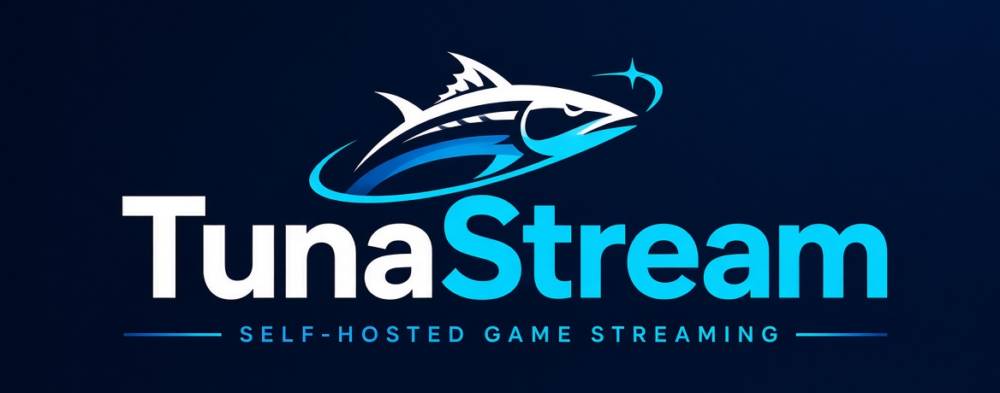
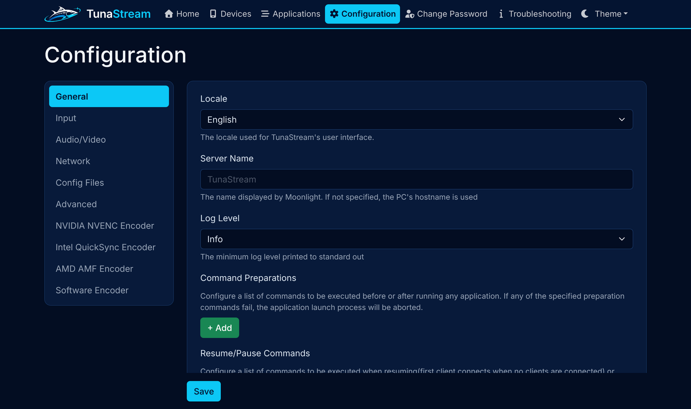

  

  Play your PC's games on your phone, tablet, handheld or TV. 
  A self-hosted streaming host for Windows. Play with <a href="https://github.com/bigtunafish9943/TunaReceive">TunaReceive</a> on Android TV and phones, or any <a href="https://moonlight-stream.org">Moonlight</a> client.

  

TunaStream runs on your gaming PC and streams it to another device over your network. It is built to be easy to
set up and pleasant to use.

> [!WARNING]
> TunaStream is new. Every release passes automated checks, but it has had very little testing on real hardware.
> Expect rough edges.

## What it does

- **Streams on its own virtual monitor.** Every stream gets a virtual display sized to the device you are playing
  on, with HDR. No spare monitor or dummy plug, and your real monitor keeps its own picture.
- **Gives your screen back when you stop.** The virtual display is the main display only while someone is
  streaming. Close the client and your monitor is the main display again, even if the game is left running.
- **Survives a dropped connection.** A Wi-Fi hiccup does not quit your game: it keeps running for two minutes so
  you can reconnect.
- **A clear web interface.** A home page that shows what is streaming, which devices are paired and whether the
  virtual display is working, with an End session button. Settings in plain words, with the technical ones tucked
  away. Pairing and permissions together on one Devices page.
- **Updates itself.** When a new version is out, the home page offers *Update now*; TunaStream downloads it,
  checks it and installs it, keeping your settings and paired devices.
- **Controller rumble you can test.** Rumble is sent to the client within about 20 ms, and the Troubleshooting
  page can buzz the controller directly so you can tell a game problem from a client problem.
- **Permissions for each device**, with one-click presets such as *Controller only*.
- **Hardware encoding** on AMD, Intel and Nvidia GPUs, with a software fallback.
- Clipboard sync, input-only mode, and commands that run when a device connects or disconnects.

  

## Install

1. **Download the installer.** Open [Releases](https://github.com/bigtunafish9943/TunaStream/releases/latest)
   and download `TunaStream-<version>-setup.exe`.
2. **Run it.** Windows will warn about an unknown publisher because the installer is not
   code-signed; choose **More info**, then **Run anyway**. The installer also sets up the virtual display and
   virtual gamepad drivers.
3. **Open TunaStream** from the Start menu or its tray icon, and create the username and password you will use
   for the web interface. The home page then shows the steps to pair your first device.

After that, you don't need to come back here: new versions show up on the home page with an *Update now* button.

Already running another streaming host such as Sunshine? You can keep it. The installer notices and gives
TunaStream its own port (48989) and a name ending in `-TunaStream`, so both can run and show up separately in your
client.

## Pair a device

1. Install [Moonlight](https://moonlight-stream.org) on the device you want to play on. On Android,
   [Artemis](https://github.com/ClassicOldSong/moonlight-android) adds control over the virtual display.
2. Add your PC in the client. It shows a PIN.
3. In TunaStream, open **Devices**, enter that PIN and give the device a name.
4. Pick **Desktop** or a game in the client.

The first device you pair gets every permission. Devices paired later can only view streams and list apps until you
grant more, so if a new device says `Permission Denied`, or its mouse and keyboard do nothing, edit it under
**Devices** and turn on *Launch Apps*, *Mouse Input* or *Keyboard Input*.

## Good to know

- **Using the PC while it streams.** The stream's virtual display is an extra monitor on the same Windows desktop,
  so your real monitor stays usable. While someone is streaming, the virtual display is the main display, so
  games open on the stream. So do new windows and notifications: turn on Do Not Disturb if those shouldn't show
  on the TV. Windows still has one mouse, one keyboard and one focused window for both of you, so clicking a window
  on your monitor takes focus away from the game. It works best when the person streaming plays with a
  controller: under **Devices**, edit their device and choose *Controller only*, and under
  **Settings > Screen and sound** turn on *Keep my mouse off the stream's screen*.
- **A game keeps running after you close the client.** That is the default, so you can pick up where you left
  off. Turn on *Quit the game when the last device disconnects* under **Settings > General**, or *Terminate on
  Pause* for a single app, to quit it instead.
- **Running next to another streaming host.** TunaStream appears in your client as a separate PC and needs its
  own pairing. If the client doesn't find it, add it by hand using the PC's IP address and the port, such as
  `192.168.1.20:48989`. Stream from one host at a time.
- **Other virtual display drivers.** Remove them before using TunaStream; two at once cause conflicts.
- **Laptops with two GPUs.** Under **Settings > Screen and sound > Advanced settings**, set *Graphics card* to
  the discrete GPU.
- **HDR** needs Windows 11 23H2 or later, and how good it looks depends mostly on the device you stream to.

Something not working? See [troubleshooting](docs/troubleshooting.md) for rumble, connection and stop/start
problems.

## Requirements

| | Minimum |
|---|---|
| OS | Windows 10 or later |
| GPU | AMD VCE 1.0+, Intel with QuickSync, or an NVENC-capable Nvidia card |
| CPU | AMD Ryzen 3 or Intel Core i3 |
| RAM | 4 GB |
| Network | 5 GHz Wi-Fi (802.11ac). Wired Ethernet is recommended for 4K |

## Where it's going

See the [roadmap](ROADMAP.md). Found a bug or have an idea?
[Open an issue](https://github.com/bigtunafish9943/TunaStream/issues).

## Building

Every push builds the Windows installer with GitHub Actions and runs a smoke test against it, and every build of
`master` is published as a release; see
[`build-windows.yml`](.github/workflows/build-windows.yml). To build on your own PC, follow
[docs/building.md](docs/building.md).

## License and credits

TunaStream is free software under the [GPL-3.0](LICENSE). It started from these open-source projects, and
owes them a great deal:

- [Apollo](https://github.com/ClassicOldSong/Apollo) by ClassicOldSong, which TunaStream began as a copy of:
  the virtual display support, per-device permissions and much more come from it.
- [Sunshine](https://github.com/LizardByte/Sunshine) by LizardByte, the streaming host Apollo is built on.
- [SudoVDA](https://github.com/SudoMaker/SudoVDA) by SudoMaker, the virtual display driver TunaStream installs.
- [Moonlight](https://moonlight-stream.org), the open-source client TunaStream streams to, and the GameStream
  protocol work behind it.

Their authors and licenses are listed in [NOTICE](NOTICE).
